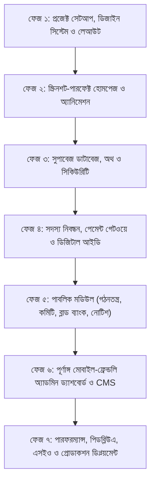

# ঢাকাস্থ কিশোরগঞ্জ উপজেলা সমিতি — মাস্টার প্রজেক্ট ব্লুপ্রিন্ট ও স্টেপ-বাই-স্টেপ এআই প্রম্পট গাইড (prompt.md)

> **প্রজেক্টের নাম:** ঢাকাস্থ কিশোরগঞ্জ উপজেলা সমিতি অফিশিয়াল ওয়েব পোর্টাল (Kishoreganj Upazila Samity, Dhaka)  
> **স্লোগান:** *"শেকড়ের টানে একতার বন্ধনে"*  
> **টেক স্ট্যাক:** Next.js 14/15 (App Router), TypeScript, Tailwind CSS, Framer Motion, Supabase (PostgreSQL, Auth, Storage, RLS), Lucide Icons, QR Code & PDF Generator.  
> **ডিজাইন রেফারেন্স:** `screnshoot/` ফোল্ডারের ৩টি স্ক্রিনশট এবং `architecture.md` মাস্টার স্পেসিফিকেশন।

---

## 🎨 ডিজাইন সিস্টেম ও ভিজ্যুয়াল গাইডলাইন (স্ক্রিনশট বিশ্লেষণ অনুযায়ী)

স্ক্রিনশটের ওপর ভিত্তি করে পুরো প্রজেক্টে নিচের কালার ও ডিজাইন টোকেনগুলো কঠোরভাবে অনুসরণ করতে হবে:

| এলিমেন্ট | কালার কোড / Tailwind ক্লাস | ব্যবহারের স্থান |
| :--- | :--- | :--- |
| **ডিপ ফরেস্ট গ্রিন (Primary)** | `#0B3B2C` / `bg-[#0B3B2C]` | হেডার, ব্যানার, ফুটার, ডার্ক কার্ড, প্রধান টেক্সট |
| **স্কাই ব্লু / সায়ান (Secondary)** | `#00A3E0` / `bg-[#00A3E0]` | নদী/ওয়েভ, অ্যাকসেন্ট বাটন ("কল করুন"), লিংক ও ট্যাগ |
| **গোল্ডেন সান ইয়েলো (Accent)** | `#FBBF24` / `#F59E0B` | প্রাইমারি বাটন ("আপডেট পেতে যুক্ত হোন", "সদস্য হোন"), স্লোগান |
| **সানসেট রেড (Accent)** | `#DC2626` / `#E11D48` | উদীয়মান সূর্য (Hero Sun), জরুরি কল/রক্তদান, নোটিফিকেশন |
| **ওয়ার্ম ব্যাকগ্রাউন্ড (Surface)** | `#FDFBF7` / `#F9F7F1` | বডি ব্যাকগ্রাউন্ড, সফট ক্রিম ফিলিং |
| **পিওর হোয়াইট (Card)** | `#FFFFFF` | ফিচার্ড কার্ড, কন্টাক্ট কার্ড, ফর্ম ব্যাকগ্রাউন্ড |
| **ফন্ট ফ্যামিলি (Bengali)** | `Hind Siliguri`, `Tiro Bangla` | আধুনিক, পাঠযোগ্য বাংলা টাইপোগ্রাফি |

---

## 🗺️ প্রজেক্ট রোডম্যাপ ও ফেজ সারসংক্ষেপ



---

# 🚀 স্টেপ-বাই-স্টেপ ফেজ প্রম্পট ডিরেক্টরি

আপনি প্রতিটি ফেজের নিচের **"📋 মাস্টার প্রম্পট"** টি হুবহু কপি করে আপনার এআই কোডিং অ্যাসিস্ট্যান্টকে (Google AI Studio, Antigravity, Claude, Cursor) দিতে পারবেন। প্রতিটি ফেজ সম্পন্ন হলে পরবর্তী ফেজে যাবেন।

---

## ফেজ ১: প্রজেক্ট ইনিশিয়ালাইজেশন, থিম কনফিগারেশন ও রেসপনসিভ লেআউট

### লক্ষ্য ও উদ্দেশ্য:
Next.js (App Router), TypeScript, Tailwind CSS সেটআপ করা, স্ক্রিনশটের কালার প্যালেট কনফিগার করা, গুগল বাংলা ফন্ট যুক্ত করা, এবং স্ক্রিনশট ৩ অনুযায়ী গ্লোবাল হেডার, বটম ন্যাভিগেশন বার ও ওয়েভ ফুটার তৈরি করা।

### স্ক্রিনশট সংযোগ:
- **হেডার:** স্ক্রিনশট ১-এর মতো বামে গোল লোগো + "কিশোরগঞ্জ উপজেলা সমিতি, ঢাকা" এবং ডানে ট্রান্সপারেন্ট বর্ডারযুক্ত "যোগাযোগ" পিল বাটন।
- **ফুটার:** স্ক্রিনশট ৩-এর মতো কার্ভড ওয়েভ ডিভাইডার, ডিপ ফরেস্ট গ্রিন ব্যাকগ্রাউন্ড, সেন্টারে লোগো, স্লোগান ও কপিরাইট টেক্সট।
- **মোবাইল বটম বার:** মোবাইলে সহজে নেভিগেট করার জন্য হোম, নোটিশ, সদস্য ফরম ও প্রোফাইল মেনু।

---

### 📋 ফেজ ১ এর মাস্টার প্রম্পট (AI-কে দেওয়ার জন্য কপি করুন):

```text
তুমি একজন সিনিয়র ফুল-স্ট্যাক ও ইউআই/ইউএক্স ইঞ্জিনিয়ার। আমরা "ঢাকাস্থ কিশোরগঞ্জ উপজেলা সমিতি"-র জন্য একটি আধুনিক ও প্রফেশনাল ওয়েব পোর্টাল তৈরি করছি। এটি প্রজেক্টের "ফেজ ১: ফাউন্ডেশন ও গ্লোবাল লেআউট"।

দয়া করে নিচের নির্দেশনাগুলো অক্ষরে অক্ষরে বাস্তবায়ন করো:

১. প্রজেক্ট সেটআপ ও ডিপেনডেন্সি:
- Next.js (App Router, TypeScript) প্রজেক্ট স্ট্রাকচার তৈরি করো।
- প্রয়োজনীয় প্যাকেজ ইনস্টল করো: tailwindcss, lucide-react, framer-motion, clsx, tailwind-merge.

২. ফন্ট ও স্টাইলিং কনফিগারেশন:
- Google Fonts থেকে 'Hind Siliguri' এবং 'Tiro Bangla' ফন্ট কনফিগার করো (next/font/google দিয়ে)।
- tailwind.config.ts ফাইলে নিচের কাস্টম কালার প্যালেট ও থিম যুক্ত করো:
  * primary: { DEFAULT: '#0B3B2C', light: '#145A43', dark: '#06261C' } // ডিপ ফরেস্ট গ্রিন
  * sky: { DEFAULT: '#00A3E0', hover: '#0284C7' } // নদীর সায়ান নীল
  * golden: { DEFAULT: '#FBBF24', hover: '#F59E0B' } // গোল্ডেন সান ইয়েলো
  * crimson: '#DC2626' // উদীয়মান লাল সূর্য
  * surface: '#FDFBF7' // উষ্ণ ক্রিম ব্যাকগ্রাউন্ড

৩. রেসপনসিভ গ্লোবাল হেডার (Navbar):
- স্ক্রিনশটের হুবহু লুক: বামে বৃত্তাকার লোগো এবং বোল্ড বাংলা টেক্সট "কিশোরগঞ্জ উপজেলা সমিতি, ঢাকা"।
- ডেস্কটপ মেনু: হোম, পরিচিতি ও গঠনতন্ত্র, কমিটি, নোটিশ, ব্লাড ব্যাংক, কল্যাণ তহবিল।
- ডানে অ্যাকশন বাটন: "যোগাযোগ" (স্ক্রিনশটের মতো গ্লাস-মর্ফিজম বর্ডার বাটন) এবং "সদস্য হোন / লগইন" বাটন।
- মোবাইলের জন্য একটি আধুনিক স্লিক হ্যামবার্গার ড্রয়ার মেনু।

৪. স্ক্রিনশট ৩ অনুযায়ী কার্ভড ওয়েভ ফুটার (Wave Footer):
- ফুটারের উপরে একটি স্মুথ অর্গানিক ওয়েভ ডিভাইডার (SVG Wave) থাকবে যা হালকা ক্রিম ব্যাকগ্রাউন্ড থেকে ডিপ ফরেস্ট গ্রিনে রূপান্তর ঘটাবে।
- ফুটারের মাঝে সেন্টারে থাকবে সমিতির বৃত্তাকার লোগো।
- টাইটেল: "কিশোরগঞ্জ উপজেলা সমিতি, ঢাকা" (সাদা বোল্ড টেক্সট)।
- স্লোগান: "শেকড়ের টানে একতার বন্ধনে" (গোল্ডেন ইয়েলো টেক্সট)।
- অফিসিয়াল কপিরাইট: "© ২০২৬ কিশোরগঞ্জ উপজেলা সমিতি, ঢাকা। সর্বস্বত্ব সংরক্ষিত।"
- গুরুত্বপূর্ণ পেজ ও সোশ্যাল মিডিয়া লিংক।

৫. মোবাইল বটম ন্যাভিগেশন বার (Fixed Mobile Bottom Nav):
- মোবাইল স্ক্রিনে নিচে ফিক্সড থাকবে (Home, Notices, Register, Profile/Login)।
- একটিভ স্টেট হাইলাইট এবং স্মুথ ট্যাপ এনিমেশন থাকবে।

দয়া করে টাইপস্ক্রিপ্ট টাইপ সেফটি বজায় রেখে প্রয়োজনীয় কম্পোনেন্টগুলো (Navbar, Footer, MobileNav, RootLayout) সম্পূর্ণ কোডসহ বানিয়ে দাও।
```

---

## ফেজ ২: স্ক্রিনশট-পারফেক্ট হোমপেজ ও ডাইনামিক হিরো সেকশন

### লক্ষ্য ও উদ্দেশ্য:
`screnshoot/` ফোল্ডারের ৩টি স্ক্রিনশটের হুবহু ভিজ্যুয়াল অ্যাপিয়ারেন্স ও এনিমেশন কোডে রূপান্তরিত করা। কামিং-সুন ডিজাইনকে লাইভ পোর্টালে আপগ্রেড করা যেখানে সরাসরি কার্যকর বাটন থাকবে।

### স্ক্রিনশট বিশ্লেষণ ও কম্পোনেন্ট ম্যাপিং:
1. **Hero Section (Screenshot 1):**
   - গ্রামীণ বাংলার আবহে ডিপ ফরেস্ট গ্রিন থেকে গোল্ডেন অলিভ গ্র্যাডিয়েন্ট আকাশ।
   - উড়ন্ত পাখির সিলুয়েট এবং ভাসমান সাদা মেঘ।
   - ডানপাশে উজ্জ্বল বড় লাল সূর্য (Sunset Red Sun)।
   - সবুজ পাহাড়ের ঢেউ খেলানো স্তর (Rolling Hills) এবং তালগাছ/গাছের সিলুয়েট।
   - নিচে প্রবাহিত নদী (সায়ান/আকাশী ব্লু ওয়েভস) এবং হলুদ পালতোলা ঐতিহ্যবাহী নৌকা।
   - সেন্টারে সমিতির অফিশিয়াল গোল্ডেন ব্যাজ লোগো।
   - স্লোগান: "শেকড়ের টানে একতার বন্ধনে" (সোনালী টেক্সট)।
   - মূল শিরোনাম: "কিশোরগঞ্জ উপজেলা সমিতি, ঢাকা"।
   - বিবরণ: "ঢাকায় বসবাসরত কিশোরগঞ্জবাসীর মিলনমেলা — শেকড়ের বন্ধনে আবদ্ধ এক পরিবার।"
   - কল-টু-অ্যাকশন (CTA) বাটন:
     * "সদস্য হোন" (গোল্ডেন ইয়েলো বাটন)
     * "লগইন / ড্যাশবোর্ড" (সায়ান ব্লু বাটন)
     * "জরুরি যোগাযোগ" (বর্ডারড বাটন)
   - নিচে মাউস স্ক্রল ডাউন ইন্ডিকেটর।

2. **Featured Cards Section ("নতুন ওয়েবসাইটে আপনার জন্য") (Screenshot 2):**
   - উপরে সফট পিল ব্যাজ: `যা থাকছে`।
   - মেইন টাইটেল: `নতুন ওয়েবসাইটে আপনার জন্য`।
   - সাবটাইটেল: `সমিতির সকল কার্যক্রম, খবর ও সদস্যদের তথ্য এক জায়গায়।`
   - ৪টি ইন্টারেক্টিভ হোয়াইট কার্ড (হোভার এফেক্ট ও শ্যাডো সহ):
     1. **সদস্য নিবন্ধন:** সফট গ্রিন আইকন বক্স + ডেসক্রিপশন + লিংক `/register`
     2. **সংবাদ ও নোটিশ:** সফট অ্যাম্বার আইকন বক্স + ডেসক্রিপশন + লিংক `/notices`
     3. **অনুষ্ঠান ও আয়োজন:** সফট রোজ/রেড আইকন বক্স + ডেসক্রিপশন + লিংক `/activities`
     4. **ফটো গ্যালারি:** সফট স্কাই ব্লু আইকন বক্স + ডেসক্রিপশন + লিংক `/gallery`

3. **Newsletter / Updates Section (Screenshot 2):**
   - ডিপ ফরেস্ট গ্রিন ব্যানার কার্ড (রাউন্ডেড কর্নার)।
   - ব্যাকগ্রাউন্ডে ডেকোরেটিভ কনসেন্ট্রিক রিং ও লাল সূর্য আর্ট।
   - টাইটেল: `প্রকাশের সাথে সাথেই জানুন`।
   - সাবটাইটেল: `আপনার ইমেইল দিন — সমিতির সকল নতুন আপডেট ও খবরাখবর আমরা আপনাকে জানিয়ে দেব।`
   - পিল শেইপ ইনপুট ফিল্ড ও গোল্ডেন `যুক্ত হোন` বাটন।

4. **Contact Cards Section (Screenshot 3):**
   - পিল ব্যাজ: `যোগাযোগ`।
   - টাইটেল: `আমাদের সাথে যোগাযোগ করুন`।
   - ৩টি দৃষ্টিনন্দন কন্টাক্ট কার্ড:
     * **অস্থায়ী কার্যালয়:** গ্রিন লোকেশন আইকন, ঠিকানা: "বাড়ি-১৬, রোড-৩/১, ব্লক-এ, সেক্টর-১৬, উত্তরা, ঢাকা-১২৩০"
     * **মোবাইল:** পিংক/রেড ফোন আইকন, নম্বর: "০১৩৫৩-৭৪৩৫৪৭" (ক্লিক-টু-কল)
     * **ইমেইল:** স্কাই ব্লু ইনবক্স আইকন, ইমেইল: "kishoreganjupazilasamity@gmail.com" (মেইলটো লিংক)

---

### 📋 ফেজ ২ এর মাস্টার প্রম্পট (AI-কে দেওয়ার জন্য কপি করুন):

```text
তুমি একজন দক্ষ ফ্রন্টএন্ড আর্টিস্ট ও নেক্সট.জেএস ডেভেলপার। আমরা "ঢাকাস্থ কিশোরগঞ্জ উপজেলা সমিতি"-র হোমপেজ নিখুঁতভাবে তৈরি করব যা আমাদের দেওয়া স্ক্রিনশটগুলোর সাথে হুবহু সামঞ্জস্যপূর্ণ হবে।

দয়া করে `app/page.tsx` এবং এর সাব-কম্পোনেন্টগুলো নিচের স্পেসিফিকেশন অনুযায়ী তৈরি করো:

১. হিরো সেকশন (`components/home/HeroSection.tsx`):
- স্ক্রিনশট ১-এর মতো গ্রামীণ পরিবেশের ডিজিটাল ইলাস্ট্রেশন CSS/SVG দিয়ে ফুটিয়ে তোলো:
  * ব্যাকগ্রাউন্ড: গাঢ় সবুজ থেকে অলিভ গ্র্যাডিয়েন্ট।
  * ডানপাশে ভাস্বর বড় লাল সূর্য (Crimson Sun: #DC2626)।
  * ঢেউ খেলানো সবুজ পাহাড় (Rolling green hills) এবং তালগাছের সিলুয়েট।
  * নদীর অ্যানিমেশন: নিচে সায়ান কালারের নদীর ঢেউ (Animated SVG waves) এবং একটি ঐতিহ্যবাহী পালতোলা নৌকা (Wooden boat with yellow sail) যা হালকা দুলবে (Framer Motion bobbing animation)।
  * সেন্টারে সমিতির গোল্ডেন লোগো ব্যাজ।
  * গোল্ডেন টেক্সট স্লোগান: "শেকড়ের টানে একতার বন্ধনে"।
  * মার্জিত বাংলা টাইটেল: "কিশোরগঞ্জ উপজেলা সমিতি, ঢাকা"।
  * সাবটাইটেল: "ঢাকায় বসবাসরত কিশোরগঞ্জবাসীর মিলনমেলা — আমাদের ঐক্য, ঐতিহ্য ও সেবার ঠিকানা।"
  * অ্যাকশন বাটন গ্রুপ:
    1. "সদস্য হোন" (গোল্ডেন পিল বাটন: bg-[#FBBF24] hover:bg-[#F59E0B] text-slate-900 font-bold px-6 py-3 rounded-full)
    2. "লগইন" (সায়ান পিল বাটন: bg-[#00A3E0] hover:bg-[#0284C7] text-white px-6 py-3 rounded-full)
    3. "জরুরি যোগাযোগ" (গ্লাস বর্ডার বাটন: border border-white/40 text-white hover:bg-white/10 px-6 py-3 rounded-full)
  * নিচে স্মুথ বাউন্সিং স্ক্রল ইন্ডিকেটর মাউস আইকন।

২. ফিচার্ড কার্ড সেকশন (`components/home/FeaturedServices.tsx`):
- স্ক্রিনশট ২ হুবহু ফলো করো:
  * হালকা ক্রিম ব্যাকগ্রাউন্ড (`#FDFBF7`)।
  * উপরে পিল ব্যাজ: "যা থাকছে" (`bg-emerald-100 text-emerald-800 text-xs px-3 py-1 rounded-full`)।
  * সেকশন হেডার: "নতুন ওয়েবসাইটে আপনার জন্য" (ডিপ গ্রিন ফন্ট)।
  * ৪টি হোয়াইট কার্ড গ্রিড (rounded-2xl, p-6, shadow-sm, hover:shadow-lg, transition-all duration-300):
    1. সদস্য নিবন্ধন: লাইট গ্রিন ব্যাকগ্রাউন্ডের ভেতর ইউজার আইকন, টাইটেল, ডেসক্রিপশন ("অনলাইনে সহজেই সমিতির সদস্য হওয়ার সুযোগ ও সদস্য তালিকা।")।
    2. সংবাদ ও নোটিশ: লাইট ইয়েলো আইকনে নিউজপেপার সিম্বল, ডেসক্রিপশন ("সমিতির সর্বশেষ খবর, ঘোষণা ও গুরুত্বপূর্ণ বিজ্ঞপ্তি।")।
    3. অনুষ্ঠান ও আয়োজন: লাইট রেড আইকনে ক্যালেন্ডার সিম্বল, ডেসক্রিপশন ("মিলনমেলা, সাংস্কৃতিক ও সামাজিক কর্মসূচির সময়সূচি।")।
    4. ফটো গ্যালারি: লাইট সায়ান আইকনে ইমেজ গ্যালারি সিম্বল, ডেসক্রিপশন ("আমাদের সকল আয়োজনের স্মরণীয় মুহূর্তগুলোর ছবি।")।

৩. নিউজলেটার / সাবস্ক্রিপশন কার্ড (`components/home/NewsletterSection.tsx`):
- স্ক্রিনশট ২-এর নিচের ডার্ক গ্রিন বক্সটির হুবহু বাস্তবায়ন:
  * ব্যানার কন্টেইনার: `bg-[#0B3B2C] rounded-3xl p-8 md:p-12 relative overflow-hidden text-center`
  * ডেকোরেশন: পেছনে হালকা লাল সূর্যের অর্ধবৃত্ত ও কার্ভড ওয়েভ লাইন।
  * হেডিং: "প্রকাশের সাথে সাথেই জানুন" (হোয়াইট বোল্ড)।
  * টেক্সট: "আপনার ইমেইল দিন — সমিতি সম্পর্কিত সকল নতুন আপডেট দ্রুত পেয়ে যাবেন।"
  * ইনপুট গ্রুপ: সেন্টারে ম্যাক্স-উইথ পিল ইনপুট ফিল্ড ও গোল্ডেন "যুক্ত হোন" বাটন। সাকসেস স্টেট টোস্ট মেসেজ সহ।

৪. কন্টাক্ট সেকশন (`components/home/ContactSection.tsx`):
- স্ক্রিনশট ৩ হুবহু ফলো করো:
  * পিল ব্যাজ: "যোগাযোগ"।
  * হেডিং: "আমাদের সাথে যোগাযোগ করুন"।
  * ৩টি কার্ড:
    1. অস্থায়ী কার্যালয়: বাড়ি-১৬, রোড-৩/১, ব্লক-এ, সেক্টর-১৬, উত্তরা, ঢাকা-১২৩০ (ম্যাপ লিংক সহ)।
    2. মোবাইল: ০১৩৫৩-৭৪৩৫৪৭ (সরাসরি ক্লিক করলে ডায়াল হবে: tel:01353743547)।
    3. ইমেইল: kishoreganjupazilasamity@gmail.com (mailto লিংক)।

সবগুলো সেকশনে Framer Motion দিয়ে স্ক্রল-ইন ফেড-ইন এনিমেশন দাও যেন ইউজার স্ক্রল করার সাথে সাথে পৃষ্ঠাটি জীবন্ত মনে হয়।
```

---

## ফেজ ৩: সুপাবেজ ডাটাবেজ আর্কিটেকচার, অথেন্টিকেশন ও আরএলএস পলিসি

### লক্ষ্য ও উদ্দেশ্য:
`architecture.md`-এর সকল প্রয়োজনীয়তা অনুসারে সুপাবেজ (Supabase PostgreSQL) স্কিমা প্রস্তুত করা, ইউজার অথেন্টিকেশন (রোল বেসড: সাধারণ ইউজার, সদস্য, অ্যাডমিন, সুপার অ্যাডমিন), এবং কঠোর Row Level Security (RLS) পলিসি তৈরি করা।

### ডাটাবেজ মডেলিং:
- `profiles`: ব্যবহারকারীর নাম, ফোন নম্বর, ইমেইল, রোল (`super_admin`, `admin`, `member`, `guest`), অবতার।
- `members`: সদস্য কোড (`KUSD-2026-XXXX`), সদস্য টাইপ (`general`, `lifetime`, `donor`), রক্তের গ্রুপ, স্থায়ী ঠিকানা (কিশোরগঞ্জ উপজেলা, গ্রাম), বর্তমান ঢাকা ঠিকানা, পেশা, শিক্ষাগত যোগ্যতা, ভেরিফিকেশন স্ট্যাটাস (`pending`, `approved`, `rejected`), এনআইডি ও ছবি।
- `payments`: পেমেন্ট আইডি, মেম্বার আইডি, উদ্দেশ্য (`registration`, `monthly_fee`, `welfare_donation`), পরিমাণ (৳), পেমেন্ট মেথড (`bkash`, `nagad`, `rocket`, `bank`), ট্রানজেকশন আইডি (`TrxID`), স্ট্যাটাস (`pending`, `verified`, `failed`), রশিদ নম্বর (`ReceiptNo`).
- `notices`: শিরোনাম, বিস্তারিত, ক্যাটাগরি, ফাইল/পিডিএফ ইউআরএল, প্রকাশনার তারিখ, পিন স্ট্যাটাস।
- `events`: ইভেন্টের নাম, বিবরণ, তারিখ, সময়, ভেন্যু, ব্যানার ছবি।
- `gallery_items`: অ্যালবাম নাম, ছবি/ভিডিও ইউআরএল, বিবরণ, বছর।
- `blood_donors`: মেম্বার আইডি, রক্তের গ্রুপ, ঢাকার এলাকা (উত্তরা, মিরপুর, ধানমন্ডি ইত্যাদি), শেষ রক্তদানের তারিখ, সক্রিয় যোগাযোগের নম্বর, অ্যাভেইলেবিলিটি।
- `welfare_applications`: আবেদনকারীর নাম, বিষয় (`scholarship`, `medical_aid`, `emergency`), বিস্তারিত বিবরণ, প্রয়োজনীয় টাকার পরিমাণ, ডকুমেন্টস ইউআরএল, স্ট্যাটাস (`submitted`, `under_review`, `approved`, `disbursed`).
- `committee_members`: নাম, পদবি, উইং (`advisory_board`, `executive_council`), সিরিয়াল নম্বর/অগ্রাধিকার, ফোন, ছবি, মেয়াদ।

---

### 📋 ফেজ ৩ এর মাস্টার প্রম্পট (AI-কে দেওয়ার জন্য কপি করুন):

```text
তুমি একজন ক্লাউড ডাটাবেজ ও সিকিউরিটি স্পেশালিস্ট। আমরা ঢাকাস্থ কিশোরগঞ্জ উপজেলা সমিতির ওয়েব অ্যাপ্লিকেশনের জন্য Supabase PostgreSQL ব্যাকএন্ড ও Auth আর্কিটেকচার তৈরি করব।

দয়া করে নিচের কাজগুলো সম্পন্ন করে পূর্ণাঙ্গ SQL স্ক্রিপ্ট এবং Next.js সুপাবেজ ক্লায়েন্ট কনফিগারেশন তৈরি করে দাও:

১. Supabase ক্লায়েন্ট লাইব্রেরি কনফিগারেশন:
- `@supabase/supabase-js` এবং `@supabase/ssr` দিয়ে `utils/supabase/client.ts`, `server.ts` ও `middleware.ts` তৈরি করো।
- সেশন রিফ্রেশিং ও কুকি হ্যান্ডলিং নিশ্চিত করো।

২. সম্পূর্ণ PostgreSQL ডাটাবেজ স্কিমা (DDL):
- `profiles` টেবিল (id uuid references auth.users, full_name, phone, role enum('super_admin', 'admin', 'member', 'guest'), created_at).
- `members` টেবিল (id uuid, profile_id references profiles, member_no text unique, member_type enum('general', 'lifetime', 'donor'), father_name, mother_name, permanent_address_upazila, permanent_village, present_dhaka_address, profession, blood_group, photo_url, nid_no, status enum('pending', 'approved', 'rejected') default 'pending', approved_at, approved_by).
- `payments` টেবিল (id uuid, member_id references members, amount numeric, fee_type enum('registration', 'monthly_subscription', 'donation'), payment_method enum('bkash', 'nagad', 'rocket', 'bank'), trx_id text unique, receipt_number text unique, status enum('pending', 'verified', 'rejected'), created_at).
- `notices` টেবিল (id uuid, title, slug, content, attachment_url, is_pinned boolean, published_at).
- `events` ও `gallery_items` টেবিল।
- `blood_donors` টেবিল (id uuid, member_id, blood_group, dhaka_area, last_donation_date, is_available boolean, contact_number).
- `welfare_applications` টেবিল (id uuid, applicant_name, applicant_phone, category enum('education', 'treatment', 'relief'), amount_requested, documents_url, status enum('pending', 'approved', 'rejected')).
- `committee_members` টেবিল (id uuid, name, designation, committee_type enum('advisory', 'executive'), order_index int, phone, photo_url, tenure_years).

৩. অটোমেশন ও ট্রিগার ফাংশন:
- নতুন ইউজার সাইন আপ করলে স্বয়ংক্রিয়ভাবে `profiles` টেবিলে ডাটা ইনসার্ট হওয়ার জন্য `handle_new_user()` ট্রিগার।
- সদস্যপদ অনুমোদিত (approved) হলে স্বয়ংক্রিয় ইউনিক মেম্বারশিপ নম্বর (উদা: KUSD-2026-0001) জেনারেট হওয়ার ট্রিগার।
- পেমেন্ট ভেরিফাইড হলে ডিজিটাল রসিদ নম্বর (উদা: REC-2026-0001) জেনারেট হওয়ার ফাংশন।

৪. Row Level Security (RLS) পলিসি:
- ব্যবহারকারীরা শুধুমাত্র তাদের নিজেদের প্রোফাইল, সদস্যপদ এবং পেমেন্ট দেখতে ও আপডেট করতে পারবে।
- শুধুমাত্র অ্যাডমিনরা সদস্যদের স্ট্যাটাস পরিবর্তন, পেমেন্ট ভেরিফাই এবং নোটিশ/কমিটি এডিট করতে পারবে।
- পাবলিক ইউজাররা অনুমোদিত নোটিশ, পাবলিশ করা কমিটি এবং ব্লাড ডোনারের বেসিক তথ্য দেখতে পাবে।

একটি সম্পূর্ণ `supabase/migrations/001_initial_schema.sql` ফাইল আউটপুট দাও যা সরাসরি Supabase SQL Editor এ রান করা যাবে।
```

---

## ফেজ ৪: সদস্য নিবন্ধন, অনলাইন পেমেন্ট ফ্লো ও ডিজিটাল আইডি কার্ড

### লক্ষ্য ও উদ্দেশ্য:
গঠনতন্ত্রের নিয়ম মেনে ৩ ধরনের সদস্যপদ আবেদন ব্যবস্থা করা (সাধারণ: ৫০০ টাকা + মাসিক ২৫ টাকা, আজীবন: ১০,০০০ টাকা, দাতা: ৫০,০০০ টাকা), বিকাশ/নগদ পেমেন্ট সিমুলেশন ও রসিদ তৈরি, এবং স্বয়ংক্রিয় কিউআর কোড সম্বলিত ডিজিটাল আইডি কার্ড তৈরি করা।

### স্ক্রিনশট ও পোর্টাল স্পেসিফিকেশন:
- **নিবন্ধন ফর্ম (`/register`):** মাল্টি-স্টেপ রেসপনসিভ ফর্ম (ব্যক্তিগত তথ্য -> ঠিকানা ও পেশা -> ছবি ও এনআইডি আপলোড -> মেম্বারশিপ ক্যাটাগরি ও পেমেন্ট)।
- **পেমেন্ট গেটওয়ে (`/checkout`):** বিকাশ এবং নগদ ইন্টিগ্রেশন (অথবা প্রোডাকশন রেডি মক পেমেন্ট গেটওয়ে) যেখানে TrxID সাবমিট করা যাবে এবং তাৎক্ষণিক ডিজিটাল মানি রিসিট ড্যাশবোর্ডে পাওয়া যাবে।
- **ডিজিটাল আইডি কার্ড (`/dashboard/id-card`):**
  * ফ্রন্ট সাইড: সমিতির লোগো, "শেকড়ের টানে একতার বন্ধনে", সদস্যের ছবি, নাম, পদবি/টাইপ, সদস্য নম্বর, রক্তের গ্রুপ, কিউআর কোড (যা স্ক্যান করলে মেম্বার ভেরিফিকেশন পেজ খুলবে)।
  * ব্যাক সাইড: সাধারণ সম্পাদকের স্বাক্ষর, সমিতির উত্তরা কার্যালয়ের ঠিকানা, জরুরি নম্বর এবং শর্তাবলী।
  * ডাউনলোড অপশন: এক ক্লিকে হাই-রেজোলিউশন PNG অথবা PDF হিসেবে সেভ করার সুবিধা।
- **পাবলিক মেম্বার ডিরেক্টরি (`/members`):** ঢাকায় অবস্থানরত অনুমোদিত সদস্যদের ফিল্টারেবল ডিরেক্টরি (গোপনীয়তা বজায় রেখে ফোন নম্বর মাস্কিং বা কন্ট্রোল করার সুবিধাসহ)।

---

### 📋 ফেজ ৪ এর মাস্টার প্রম্পট (AI-কে দেওয়ার জন্য কপি করুন):

```text
তুমি একজন সিনিয়র ফুলস্ট্যাক ইঞ্জিনিয়ার। আমরা সমিতির জন্য সবচেয়ে গুরুত্বপূর্ণ মডিউল "সদস্য নিবন্ধন, পেমেন্ট ও ডিজিটাল আইডি কার্ড" সিস্টেম তৈরি করব।

দয়া করে নিচের ফিচারগুলো স্টেপ-বাই-স্টেপ কোডসহ তৈরি করে দাও:

১. সদস্য নিবন্ধন পোর্টাল (`app/(auth)/register/page.tsx`):
- গঠনতন্ত্র অনুযায়ী ৩টি ক্যাটাগরি সিলেক্ট করার অপশন:
  * সাধারণ সদস্য (নিবন্ধন ফি ৫০০ টাকা, মাসিক চাঁদা ২৫ টাকা)
  * আজীবন সদস্য (এককালীন ১০,০০০ টাকা)
  * দাতা সদস্য (এককালীন সর্বনিম্ন ৫০,০০০ টাকা)
- মাল্টি-স্টেপ বা ট্যাব বেসড বাংলা ফর্ম:
  * ধাপ ১: মূল তথ্য (নাম, পিতা/স্বামীর নাম, মাতার নাম, জন্মতারিখ, রক্তের গ্রুপ)।
  * ধাপ ২: স্থায়ী ঠিকানা (কিশোরগঞ্জ জেলা, উপজেলা, ইউনিয়ন, গ্রাম) ও বর্তমান ঢাকার ঠিকানা।
  * ধাপ ৩: পেশা, কর্মস্থল, শিক্ষাগত যোগ্যতা ও মোবাইল নম্বর।
  * ধাপ ৪: ছবি আপলোড (Supabase Storage 'member-photos' বাকেটে সেভ হবে) ও এনআইডি নম্বর।

২. পেমেন্ট ও মানি রসিদ সিস্টেম (`components/payment/PaymentModal.tsx`):
- বিকাশ (bKash) ও নগদ (Nagad) পেমেন্ট ইন্টারফেস:
  * মার্চেন্ট/ব্যক্তিগত নম্বর প্রদর্শন, ইউজার তার TrxID এবং প্রেরকের নম্বর দিয়ে সাবমিট করবে।
  * পেমেন্ট স্টেটাস 'pending' থেকে অ্যাডমিন ভেরিফাই করবে (কিংবা অটো-সিমুলেশন মোড থাকবে)।
- ডিজিটাল মানি রিসিট ভিউয়ার (`app/dashboard/receipts/[id]/page.tsx`):
  * মেম্বার নাম, রসিদ নম্বর, ট্রানজেকশন আইডি, পরিমাণ, উদ্দেশ্য ও তারিখ সম্বলিত অফিসিয়াল মানি রিসিট।
  * প্রিন্ট বা PDF ডাউনলোড বাটন।

৩. কিউআর কোড যুক্ত ডিজিটাল আইডি কার্ড (`components/dashboard/DigitalIdCard.tsx`):
- স্ক্রিনশটের ব্র্যান্ডিং ও কালার স্কিম (ডিপ গ্রিন + গোল্ডেন অ্যাকসেন্ট) দিয়ে এটি ডিজাইন করো।
- কার্ডে থাকবে:
  * সমিতির লোগো ও হেডার।
  * সদস্যের পাসপোর্ট সাইজ ছবি ও মেম্বার আইডি (উদা: KUSD-2026-0124)।
  * সদস্যের নাম, ক্যাটাগরি, রক্তের গ্রুপ, মোবাইল ও ইস্যু তারিখ।
  * একটি ডায়নামিক QR Code (`qrcode.react` দিয়ে তৈরি) যা স্ক্যান করলে সমিতির ভেরিফিকেশন ইউআরএল (`/verify-member/[id]`) খুলবে।
- পেছনের পিঠ (Back side): কার্যনির্বাহী সাধারণ সম্পাদকের ডিজিটাল সাইন, সমিতির উত্তরার ঠিকানা ও বৈধতার শর্ত।
- `html2canvas` বা `jspdf` ব্যবহার করে কার্ডটি এক ক্লিকে ডাউনলোড করার কার্যকারিতা যুক্ত করো।

৪. সদস্য ডিরেক্টরি পেজ (`app/members/page.tsx`):
- অনুমোদিত সদস্যদের তালিকা।
- রক্ত গ্রুপ, পেশা এবং ঢাকার এলাকা (উত্তরা, মিরপুর, ধানমন্ডি ইত্যাদি) দিয়ে দ্রুত ফিল্টার ও লাইভ সার্চ বার।

সব কোড সম্পূর্ণ টাইপস্ক্রিপ্ট ও হ্যান্ডেলড ভ্যালিডেশন (Zod/React Hook Form) দিয়ে তৈরি করো।
```

---

## ফেজ ৫: পাবলিক মডিউল (গঠনতন্ত্র, কমিটি, নোটিশ, ব্লাড ব্যাংক ও কল্যাণ তহবিল)

### লক্ষ্য ও উদ্দেশ্য:
`architecture.md`-এর ৩ ও ৫ নম্বর সেকশনে বর্ণিত সকল পাবলিক ও কমিউনিটি ফিচার ডেভেলপ করা—যেখানে গঠনতন্ত্রের ৩৫টি ধারা, কিশোরগঞ্জের ইতিহাস ও ঐতিহ্য, ১৫ সদস্যের উপদেষ্টা ও ৫১ সদস্যের কার্যকরী কমিটি, নোটিশ বোর্ড, ব্লাড ব্যাংক ও কল্যাণ তহবিল থাকবে।

### মডিউল বিবরণ:
1. **গঠনতন্ত্র কর্নার (`/constitution`):** ১ থেকে ৩৫ ধারা আধুনিক অ্যাকর্ডিয়ন (Accordion) আকারে সাজানো, সার্চ অপশন এবং পুরো গঠনতন্ত্রের অফিসিয়াল PDF ডাউনলোড বাটন।
2. **ঐতিহ্য ও দর্শনীয় স্থান (`/heritage` বা `/tourism`):** কিশোরগঞ্জের কৃতি ব্যক্তিত্ব (যেমন: শহীদ সৈয়দ নজরুল ইসলাম, জয়নুল আবেদিন, চন্দ্রাবতী) এবং দর্শনীয় স্থানসমূহ (পাগলা মসজিদ, এগারসিন্দুর দুর্গ, নিকলী হাওর) ইন্টারেক্টিভ কার্ড ও মোডাল পপআপ সহ।
3. **কমিটি ডিরেক্টরি (`/committee`):**
   - ১৫ সদস্য বিশিষ্ট উপদেষ্টা পরিষদ (ছবি, পদবি, কর্মস্থল)।
   - ৫১ সদস্য বিশিষ্ট কার্যনির্বাহী পরিষদ (সভাপতি, সাধারণ সম্পাদক, সহ-সভাপতি, সাংগঠনিক সম্পাদক, কোষাধ্যক্ষ ইত্যাদি মোবাইল নম্বর ও ছবি সহ)।
4. **কিশোরগঞ্জ ব্লাড ব্যাংক (`/blood-bank`):** ঢাকার যেকোনো হাসপাতালে জরুরি প্রয়োজনে কিশোরগঞ্জের রক্তদাতাদের রক্তের গ্রুপ ও এলাকার নাম দিয়ে ফিল্টার করে তাৎক্ষণিক ফোন দেওয়ার ইন্টারফেস। নতুন রক্তদাতা হিসেবে যোগদানের ফর্ম।
5. **কল্যাণ তহবিল (`/welfare`):** গরীব ও মেধাবী শিক্ষার্থীদের বৃত্তি এবং সমিতির অসচ্ছল সদস্যদের জরুরি চিকিৎসা সহায়তার জন্য আবেদন করার ফর্ম ও স্ট্যাটাস ট্র্যাকিং।

---

### 📋 ফেজ ৫ এর মাস্টার প্রম্পট (AI-কে দেওয়ার জন্য কপি করুন):

```text
তুমি একজন সিনিয়র ফ্রন্টএন্ড ও ফুলস্ট্যাক ডেভেলপার। আমরা ঢাকাস্থ কিশোরগঞ্জ উপজেলা সমিতির তথ্যবহুল ও সমাজকল্যাণমূলক পাবলিক পেজগুলো তৈরি করব।

দয়া করে নিচের পেজ ও ফিচারগুলো সম্পূর্ণ বাস্তবায়ন করে দাও:

১. গঠনতন্ত্র পেজ (`app/constitution/page.tsx`):
- ১ থেকে ৩৫ পর্যন্ত সকল ধারার তালিকা (সদস্যপদ, চাঁদার হার, নির্বাচন, তহবিল, সাধারণ সভা ইত্যাদি)।
- মোবাইল-ফ্রেন্ডলি শ্যাডসিএন/টেইলউইন্ড অ্যাকর্ডিয়ন (Accordion) কম্পোনেন্ট, যাতে যেকোনো ধারায় ক্লিক করলে বিস্তারিত বের হয়।
- ধারা সার্চ করার জন্য ফিল্টার বার।
- উপরে একটি "সম্পূর্ণ গঠনতন্ত্র (PDF) ডাউনলোড করুন" অ্যাকশন বাটন।

২. নেতৃত্ব ও কমিটি পেজ (`app/committee/page.tsx`):
- দুটি ট্যাব:
  * "উপদেষ্টা পরিষদ" (১৫ সদস্য)
  * "কার্যনির্বাহী পরিষদ" (৫১ সদস্য)
- মেম্বার কার্ড ডিজাইন: সুন্দর পোর্ট্রেট ফ্রেম, প্রফেশনাল ছবি, নাম, পদবি, রক্তের গ্রুপ এবং এক ক্লিকে কল করার বাটন (`tel:` লিংক)।

৩. কিশোরগঞ্জ ঐতিহ্য ও দর্শনীয় স্থান (`app/heritage/page.tsx`):
- কিশোরগঞ্জের ইতিহাস ও কৃতি সন্তানদের সংক্ষিপ্ত জীবন পরিচিতি।
- ইন্টারেক্টিভ ট্যুরিজম গ্যালারি (পাগলা মসজিদ, নিকলী হাওর, এগারসিন্দুর, চন্দ্রাবতীর মন্দির)। কার্ডে ক্লিক করলে আকর্ষণীয় মোডাল পপআপে বিস্তারিত ইতিহাস ও ছবি দেখাবে।

৪. কিশোরগঞ্জ ব্লাড ব্যাংক পোর্টাল (`app/blood-bank/page.tsx`):
- জরুরি রক্ত খোঁজার ফিল্টার: রক্তের গ্রুপ (A+, A-, B+, B-, AB+, AB-, O+, O-) এবং ঢাকার এলাকা (উত্তরা, মিরপুর, গুলশান, বাড্ডা ইত্যাদি)।
- ডোনার কার্ডে সরাসরি "কল করুন" বাটন।
- রক্তদাতা হওয়ার জন্য একটি সহজ রেজিস্ট্রেশন মোডাল ("রক্তদাতা হিসেবে যুক্ত হোন")।

৫. কল্যাণ তহবিল ও বৃত্তি আবেদন (`app/welfare/page.tsx`):
- শিক্ষা সহায়তা ও চিকিৎসা সহায়তা স্কিমের বিবরণ।
- অনলাইন আবেদন ফর্ম (নাম, সমস্যা, চাহিত আর্থিক সহায়তার পরিমাণ, প্রত্যয়নপত্র আপলোড)।
- আবেদন নম্বর দিয়ে ট্র্যাক করার সার্চ বার ("আবেদনের অবস্থা জানুন")।

৬. নোটিশ ও কার্যক্রম পেজ (`app/notices/page.tsx` ও `app/activities/page.tsx`):
- নোটিশের তালিকা, পিন করা নোটিশ হাইলাইট, পিডিএফ ভিউয়ার/ডাউনলোড।
- অতীত মিলনমেলা ও সভার ফটো গ্যালারি উইথ লাইটবক্স প্রিভিউ।

সবগুলো পেজে রেসপনসিভনেস ও বাংলা টাইপোগ্রাফির সৌন্দর্য বজায় রাখবে।
```

---

## ফেজ ৬: অ্যাডমিন ড্যাশবোর্ড ও কনটেন্ট ম্যানেজমেন্ট সিস্টেম (CMS)

### লক্ষ্য ও উদ্দেশ্য:
সমিতির কার্যকরী কমিটি ও কর্মকর্তাদের জন্য একটি সম্পূর্ণ সুরক্ষিত, মোবাইল-ফ্রেন্ডলি অ্যাডমিন প্যানেল (`/admin`) তৈরি করা, যেখান থেকে সদস্য অনুমোদন, পেমেন্ট অডিট, নোটিশ ও কমিটি আপডেট এবং অর্থ তহবিলের রিয়েল-টাইম হিসাব রাখা যাবে।

### ড্যাশবোর্ড ফিচারসমূহ:
- **ওভারভিউ মেট্রিক্স:** মোট সদস্য সংখ্যা, অপেক্ষমাণ পেমেন্ট যাচাই, চলতি মাসের চাঁদা আদায় (৳), ব্লাড ডোনার ও রক্তের জরুরি আবেদন, এসএমএস ব্যালেন্স।
- **গঠনতন্ত্র (Constitution) সিএমএস:** সরাসরি গঠনতন্ত্রের PDF ফাইল আপলোড/আপডেট/ডাউনলোড এবং ধারা ১ থেকে ৩৫ (ও নতুন ধারা) অ্যাড, এডিট, ডিলিট করার সম্পূর্ণ CRUD ব্যবস্থা।
- **কমিটি ও উপদেষ্টা পরিষদ ম্যানেজার:** ১৫ সদস্যের উপদেষ্টা পরিষদ এবং ৫১ সদস্যের কার্যনির্বাহী পরিষদ পরিচালনা (নাম, পদবি, মেয়াদ ২০২৬-২০২৮, মোবাইল, ইউনিয়ন, গ্রাম ও সংক্ষিপ্ত Bio)।
- **মেম্বার ম্যানেজমেন্ট ও ডিরেক্টরি কন্ট্রোল:** সদস্যদের তালিকা, যেকোনো সদস্যকে ব্লক (লগইন বন্ধ) বা আনব্লক করা, স্থায়ীভাবে ডিলিট করা, এবং একক বা বাল্ক ডিজিটাল স্মার্ট আইডি কার্ড প্রিন্ট/ডাউনলোড।
- **এসএমএস মার্কেটিং গেটওয়ে:** মেসেজ বক্স থেকে এক ক্লিকে সকল সদস্যকে, অথবা নির্দিষ্ট ইউনিয়নভিত্তিক, কিংবা একক সদস্যকে কাস্টম এসএমএস পাঠানো, লাইভ প্রিভিউ ও সেন্ট হিস্ট্রি লগ।
- **নিবন্ধন ও পেমেন্ট ভেরিফিকেশন:** বিকাশ/নগদ/রকেট TrxID যাচাই, ভেরিফাই করে Approve করলেই স্বয়ংক্রিয় কনফার্মেশন ও মেম্বার আইডি এসএমএস প্রেরণ।
- **নোটিশ বোর্ড সিএমএস:** নতুন নোটিশ প্রকাশ, পিন করা, এডিট, ডিলিট এবং কাজ শেষ হলে 'Completed' বা আর্কাইভ মার্কিং।
- **রক্তদান কর্নার মনিটরিং:** সাধারণ দর্শনার্থীদের রক্তের জরুরি রিকোয়েস্ট পোস্ট পর্যবেক্ষণ ও ডোনার সমন্বয়।
- **ইউনিয়ন পরিচিতি ও ঐতিহ্য সিএমএস:** ৯টি ইউনিয়নের চেয়ারম্যান ও ১-৯ নং ওয়ার্ড মেম্বারদের তালিকা আপডেট, দর্শনীয় স্থান ও ঐতিহাসিক ভিডিও/ছবির আর্কাইভ।
- **ইভেন্ট ও ফটো গ্যালারি সিএমএস:** ১ বছরের কার্যক্রমের স্ট্যাটাস (Upcoming / Completed / Cancelled) নিয়ন্ত্রণ এবং নতুন ছবি ও ভিডিও লিংক সংযোজন।

---

### 📋 ফেজ ৬ এর মাস্টার প্রম্পট (AI-কে দেওয়ার জন্য কপি করুন):

```text
তুমি একজন এন্টারপ্রাইজ সিস্টেম আর্কিটেক্ট। আমরা ঢাকাস্থ কিশোরগঞ্জ উপজেলা সমিতির কর্মকর্তাদের জন্য একটি পূর্ণাঙ্গ, স্বয়ংসম্পূর্ণ ও মোবাইল-ফ্রেন্ডলি অ্যাডমিন ড্যাশবোর্ড (`/admin`) তৈরি করব।

দয়া করে নিচের ১০টি মডিউল সম্পূর্ণ বাস্তবায়ন করো:

১. ড্যাশবোর্ড ওভারভিউ ও মেট্রিক্স (`app/admin/page.tsx`):
- ৪টি মূল অ্যানালিটিক্স কার্ড (অনুমোদিত সদস্য, অপেক্ষমাণ পেমেন্ট, রক্তের আবেদন ও ডোনার, এসএমএস ক্যাম্পেইন)।
- নেভিগেশন ট্যাবসমূহ: সদস্য ডিরেক্টরি, পেমেন্ট ভেরিফিকেশন, এসএমএস মার্কেটিং, গঠনতন্ত্র, কমিটি পরিষদ, নোটিশ সিএমএস, রক্তদান কর্নার, ইউনিয়ন ও ঐতিহ্য, অনুষ্ঠান ও গ্যালারি, সাইট সেটিংস।

২. গঠনতন্ত্র (Constitution) ম্যানেজমেন্ট:
- সরাসরি ড্যাশবোর্ড থেকে অফিসিয়াল PDF আপলোড ও লিংক পরিবর্তনের ব্যবস্থা।
- ধারা ১ থেকে ৩৫ (ও নতুন ধারা) অ্যাড, এডিট ও ডিলিট করার সম্পূর্ণ CRUD ইন্টারফেস।

৩. কমিটি ও উপদেষ্টা পরিষদ ম্যানেজমেন্ট:
- ১৫ উপদেষ্টা এবং ৫১ কার্যনির্বাহী সদস্যের পূর্ণাঙ্গ ডাটাবেজ।
- ফিল্ডস: নাম, পদবি, কমিটি টাইপ, মেয়াদ (২০২৬-২০২৮), মোবাইল, ইউনিয়ন, গ্রাম, সংক্ষিপ্ত Bio।

৪. সদস্য ডিরেক্টরি ও কন্ট্রোল:
- সদস্যদের প্রোফাইল ভিউ, যেকোনো সদস্যকে ব্লক/আনব্লক করা এবং স্থায়ী রিমুভ।
- ডিজিটাল স্মার্ট আইডি কার্ড একক প্রিভিউ ও প্রিন্ট, এবং এক ক্লিকে সকল সদস্যের বাল্ক আইডি কার্ড ডাউনলোড।

৫. এসএমএস মার্কেটিং ও নোটিফিকেশন গেটওয়ে:
- টার্গেট ১: সকল রেজিস্টার্ড সদস্যকে এক ক্লিকে বাল্ক এসএমএস পাঠানো।
- টার্গেট ২: ইউনিয়নভিত্তিক ফিল্টার করে পাঠানো।
- টার্গেট ৩: একক সদস্যের মোবাইলে কাস্টম এসএমএস পাঠানো।
- এসএমএস ব্যালেন্স কাউন্টার ও সেন্ট হিস্ট্রি লগ।

৬. নিবন্ধন ও পেমেন্ট ভেরিফিকেশন:
- বিকাশ/নগদ/রকেট TrxID যাচাই ও অডিট।
- Approve করলেই স্বয়ংক্রিয় ইউনিক মেম্বার আইডি তৈরি এবং কনফার্মেশন এসএমএস ট্রিগার।

৭. নোটিশ বোর্ড সিএমএস:
- নতুন নোটিশ প্রকাশ, পিন করা এবং কাজ শেষে 'Completed' মার্ক করার ফিচার।

৮. রক্তদান কর্নার মনিটরিং:
- জরুরি রক্তের রিকোয়েস্ট পোস্ট পর্যবেক্ষণ ও ডোনার সমন্বয়।

৯. ইউনিয়ন পরিচিতি ও ঐতিহ্য সিএমএস:
- ৯টি ইউনিয়নের চেয়ারম্যান এবং ১-৯ নং ওয়ার্ডের ইউপি মেম্বারদের তালিকা আপডেট।
- দর্শনীয় স্থান ও ঐতিহাসিক ভিডিও লিংক সংযোজন।

১০. অনুষ্ঠান ও ফটো গ্যালারি সিএমএস:
- ১ বছরের ইভেন্ট টাইমলাইন এবং স্ট্যাটাস (Upcoming / Completed / Cancelled)।
- নতুন ছবি ও ইউটিউব ভিডিও লিংক যুক্ত করার ব্যবস্থা।
```

---

## ফেজ ৭: অপটিমাইজেশন, পিডব্লিউএ, এসইও ও প্রোডাকশন ডিপ্লয়মেন্ট

### লক্ষ্য ও উদ্দেশ্য:
প্রজেক্টটিকে প্রোডাকশন-রেডি করা, বাংলা এসইও মেটাডাটা ও ওপেনগ্রাফ তৈরি করা, মোবাইল ডিভাইসের জন্য প্রগ্রেসিভ ওয়েব অ্যাপ (PWA) সক্ষম করা এবং Vercel + Supabase এ নির্বিঘ্নে ডিপ্লয় করার ব্যবস্থা করা।

---

### 📋 ফেজ ৭ এর মাস্টার প্রম্পট (AI-কে দেওয়ার জন্য কপি করুন):

```text
তুমি একজন ডেভঅপ্স ও এসইও এক্সপার্ট। ঢাকাস্থ কিশোরগঞ্জ উপজেলা সমিতির ওয়েব অ্যাপ্লিকেশনটি প্রোডাকশনে লঞ্চ করার জন্য চূড়ান্ত অপটিমাইজেশন ও পলিশিং করতে হবে।

দয়া করে নিচের কাজগুলো করে দাও:

১. মেটাডাটা ও এসইও কনফিগারেশন (`app/layout.tsx` ও `app/sitemap.ts`):
- ডায়নামিক মেটাডাটা: Title: "কিশোরগঞ্জ উপজেলা সমিতি, ঢাকা | শেকড়ের টানে একতার বন্ধনে"।
- Description: "ঢাকায় বসবাসরত কিশোরগঞ্জবাসীর মিলনমেলা — অনলাইন সদস্য নিবন্ধন, কল্যাণ তহবিল, ব্লাড ব্যাংক ও সার্বিক তথ্যভাণ্ডার।"
- OpenGraph ইমেজ ও সোশ্যাল শেয়ারিং কার্ড (Facebook ও WhatsApp এ লিংক শেয়ার করলে লোগো ও প্রিভিউ কার্ড সুন্দরভাবে শো করবে)।
- `robots.ts` এবং স্বয়ংক্রিয় `sitemap.ts` তৈরি করো।

২. প্রগ্রেসিভ ওয়েব অ্যাপ (PWA) কনফিগারেশন:
- `manifest.json` তৈরি করো যাতে মোবাইল ব্যবহারকারীরা ওয়েবসাইটটি অ্যাপের মতো মোবাইলের হোম স্ক্রিনে ইন্সটল (Add to Home Screen) করে ব্যবহার করতে পারে।
- থিম কালার `#0B3B2C` এবং ব্যাকগ্রাউন্ড `#FDFBF7` সেট করো। সমিতির লোগো থেকে আইকন সাইজ (192x192, 512x512) কনফিগার করো।

৩. এরর ও লোডিং স্টেটস:
- প্রতিটি রুটের জন্য আধুনিক লোডিং স্কেলিটন (`loading.tsx`) তৈরি করো।
- ইউজার ফ্রেন্ডলি বাংলা এরর পেজ (`error.tsx`, `not-found.tsx`) তৈরি করো।

৪. সিকিউরিটি ও এনভায়রনমেন্ট চেকলিস্ট:
- `.env.example` ফাইলে প্রয়োজনীয় সকল ভ্যারিয়েবল ডকুমেন্টেড করো:
  * `NEXT_PUBLIC_SUPABASE_URL`
  * `NEXT_PUBLIC_SUPABASE_ANON_KEY`
  * `SUPABASE_SERVICE_ROLE_KEY`
  * `NEXT_PUBLIC_SITE_URL`
- ডিপ্লয়মেন্ট গাইড: Vercel এ ডিপ্লয় করার স্টেপ এবং Supabase প্রজেক্ট কানেকশন গাইডলাইন।

সম্পূর্ণ ফাইলগুলো গুছিয়ে দাও।
```

---

## 🎯 প্রজেক্ট বাস্তবায়ন চেকলিস্ট (Checklist for User)

| ফেজ নম্বর | মডিউলের নাম | স্ক্রিনশট রেফারেন্স | স্ট্যাটাস |
| :---: | :--- | :--- | :---: |
| **ফেজ ১** | প্রজেক্ট সেটআপ, কালার প্যালেট, হেডার ও কার্ভড ওয়েভ ফুটার | স্ক্রিনশট ১ ও ৩ | 🔲 বাকি |
| **ফেজ ২** | গ্রামীণ আবহের লাইভ হিরো, ফিচার্ড কার্ড, নিউজলেটার ও যোগাযোগ কার্ড | স্ক্রিনশট ১, ২, ৩ | 🔲 বাকি |
| **ফেজ ৩** | সুপাবেজ ডাটাবেজ টেবিল, Auth এবং আরএলএস পলিসি | architecture.md | 🔲 বাকি |
| **ফেজ ৪** | ৩ স্তরের সদস্য নিবন্ধন, বিকাশ/নগদ পেমেন্ট ও কিউআর ডিজিটাল আইডি | architecture.md | 🔲 বাকি |
| **ফেজ ৫** | গঠনতন্ত্র (৩৫ ধারা), কমিটি (১৫+৫১), ব্লাড ব্যাংক ও কল্যাণ তহবিল | architecture.md | 🔲 বাকি |
| **ফেজ ৬** | মোবাইল-ফ্রেন্ডলি অ্যাডমিন ড্যাশবোর্ড, সদস্য ও পেমেন্ট ভেরিফিকেশন | architecture.md | 🔲 বাকি |
| **ফেজ ৭** | মোবাইল PWA, বাংলা এসইও, স্পিড অপটিমাইজেশন ও Vercel ডিপ্লয়মেন্ট | architecture.md | 🔲 বাকি |

---
*প্রস্তুতকারক: Antigravity AI — ঢাকাস্থ কিশোরগঞ্জ উপজেলা সমিতি ওয়েব প্ল্যাটফর্ম ব্লুপ্রিন্ট।*

